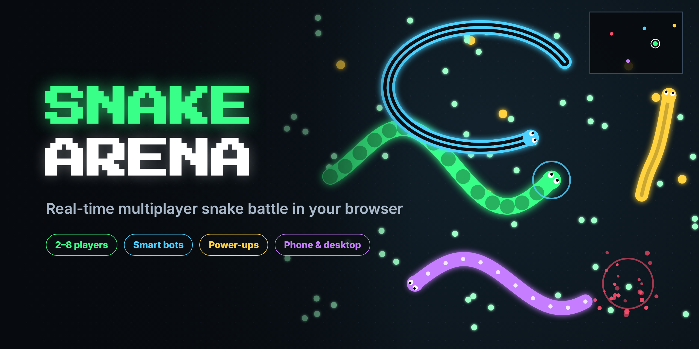

# 🐍 Snake Arena



Real-time multiplayer snake you play in the browser, on any device. Create a room, share the 4-letter code or invite link, and battle until one snake is left. Add bots to practice or fill the arena.

## How to play
- **Steer in any direction:** Your snake follows your mouse pointer. Arrow keys / WASD also work, and you can combine two for diagonals. On phones, drag anywhere like a joystick.
- **Boost:** Hold the mouse button, Space, or the BOOST button. It's faster but burns length.
- **Grow:** Eat orbs. Gold orbs give a lot more.
- **Don't crash:** If your head touches a wall, another snake's body, or another snake's head, you're out of the round. Crossing your own body is safe.
- **Power-ups:**
  - **Magnet** pulls nearby orbs to you (8s).
  - **Ghost** lets you pass through snakes (4s).
  - **Shield** saves you from one snake crash.
- **Sudden death:** After a while (30/60/90s, set by the host) the walls close in.
- **Win:** Last snake alive wins the round. First to 1/3/5 round wins (set by the host) takes the match.

## Endless mode
The host can pick **Endless** in the lobby instead of Rounds.
- It always uses the large arena, with no rounds and no closing walls.
- **Crash and you respawn instantly with half your score** (minimum 14), with 2 seconds of spawn protection.
- The top-left corner shows a **live ranking** of every player and their score (snake length), like `1. Ada: 50`, with your own row marked "(you)".
- Friends can join in the middle of a game. The host clicks **End game** to finish, and the biggest snake wins.

## Features
- 2–8 players per room. Join by code or invite link. Bots (Easy / Normal / Hard) can fill the empty slots.
- **Lobby:** pick your color and pattern (solid, stripes, dots, neon), and ready up. The host chooses the rounds to win, the arena size, and when the walls close.
- **Reconnect:** if you refresh or lose connection, you get your seat back within 30 seconds. Autopilot steers your snake while you're gone.
- **Smooth over real networks:** your own snake is predicted locally, other snakes are interpolated, and the server only sends the orbs that changed.
- **Camera and minimap:** the camera follows your snake, and a minimap shows every rival. Arrows at the screen edge point to snakes that are off-camera.
- **Game feel:** particles, screen shake on KOs, "+N" popups, and sounds with a mute button.
- **Match stats:** wins, KOs, longest snake, survival time, and awards.
- **Devices:** works on desktop, phone portrait, and phone landscape, with a full-screen button.

## Run locally
Requires Node.js 18+.
```bash
npm install
npm start
# open http://localhost:3000
```
To test multiplayer, open a second browser window (or a phone on the same Wi-Fi at `http://<your-computer-ip>:3000`).

## Deploy (Render, free)
1. Push this repo to GitHub.
2. On [render.com](https://render.com) choose **New → Blueprint** and pick the repo (it reads `render.yaml`).
3. Render gives you a public URL like `https://snake-arena-xxxx.onrender.com`. Share it.

The free plan sleeps after inactivity, so the first visit can take ~30s to wake up.

## How it works
- `server.js`: Express + Socket.IO. The server is authoritative.
  - **Simulation:** a fixed-timestep loop at 20 ticks/s. Snakes move at any angle with a limited turn rate, and bodies follow the head point by point.
  - **Collisions** use a spatial hash.
  - **Bots** come in three skill levels, set per bot in the lobby:
    - **Easy** is a simple reactive steerer.
    - **Normal** and **Hard** are planners. They simulate about 20 possible paths under the real turn-rate limit and check walls (including where the closing walls will be), bodies, and exactly when each rival head will reach each point. They flood-fill to measure free space so they avoid traps, plan cut-offs, and boost on purpose to escape or attack.
    - **Hard** thinks twice as often and plans further ahead.
    - In 3v3 tournaments (round wins): Normal beat Easy 15–3, Hard beat Easy 10–1, and Hard beat Normal 8–4.
  - **Network updates** send orbs as changes only and every other body point.
- `public/game.js`: canvas renderer and client logic.
  - **Movement:** your own snake is predicted locally; other snakes are interpolated using the measured update interval.
  - **Screen:** follow camera, minimap, particles, popups.
  - **Pages:** lobby UI.
  - **Input:** mouse, keyboard, and touch joystick.
